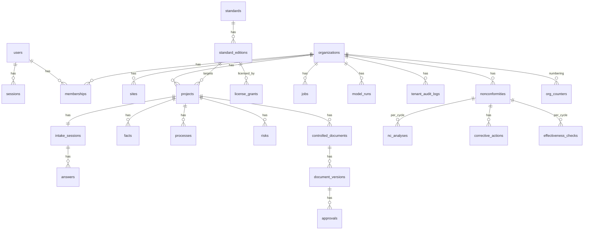

# DATA_MODEL — ERD وحوكمة العزل

## ERD (المنفّذ في 0001/0002)

## مخطط الحالات
- **projects.status:** INTAKE → BLUEPRINT → SCOPE_APPROVED → DOCUMENTING → OPERATING → ARCHIVED
- **document_versions.status:** DRAFT → IN_REVIEW → (APPROVED → EFFECTIVE → SUPERSEDED) | REJECTED | DRAFT — مفروض بمحفز `document_versions_guard`.
- **facts.status (provenance):** VERIFIED / CLIENT_PROVIDED / INFERRED / MISSING / CONFLICTED / NOT_APPLICABLE.
- **nonconformities.status:** OPEN → CONTAINED → ACTION_PLANNED → IMPLEMENTED → CLOSED؛ IMPLEMENTED → CONTAINED (غير فعّال، دورة جديدة)؛ CONTAINED → CLOSED (تصحيح فقط، MINOR) — مفروض بمحفز `nonconformities_guard`؛ الحالة المغلقة غير قابلة للتعديل؛ تاريخ الاكتشاف لا يكون مستقبلياً؛ الإجراء المنفذ/الملغى نهائي (`corrective_actions_guard`)؛ `nc_analyses` و`effectiveness_checks` إلحاقية فقط.
- **jobs.status:** QUEUED → RUNNING → SUCCEEDED | (QUEUED بإعادة محاولة أُسية) → DEAD.

## العزل
- كل جدول مستأجر: `org_id NOT NULL` + سياسة `tenant_isolation` (USING + WITH CHECK).
- `organizations`/`memberships`: سياسات تسمح للمستخدم برؤية عضوياته فقط.
- اختبارات: SELECT بلا WHERE، INSERT بـ org_id أجنبي، UPDATE/DELETE بمعرف أجنبي، سياق فارغ، دوال المجال بمعرفات مزورة، صفحات الويب والتنزيل (404)، اختبار طفرة يثبت فشل الاختبارات عند تعطيل RLS.
- **فجوة معروفة:** جدول `users` بلا RLS (يحتاجه تسجيل الدخول). المعالجة المخططة: دالة SECURITY DEFINER للبحث بالبريد + RLS على users (P1-hardening).

## كيانات الميثاق §14 — التغطية
منفّذ: organizations, sites, users, memberships, roles/permissions (كود), projects, standards, standard_editions, license_grants, intake_sessions, questionnaires (كود الحزم), answers, verified_facts (facts), processes, risks/opportunities, controlled_documents, document_versions, approvals, generation_jobs (jobs), model_runs/model_costs, tenant_audit_logs.
منفّذ في 0003: nonconformities, corrective_actions (+ nc_analyses, effectiveness_checks, org_counters).
مخطط (P3/P4): customers, service_orders, pricing_plans, subscriptions, invoices, payments, industry_packs/jurisdiction_packs (جداول)، requirements/requirement_applicability (بعد الترخيص)، source_files, evidence, RACI_assignments, objectives, KPIs, records, suppliers, customer_feedback, trainings, audits, findings, management_reviews, review_tasks, notifications.

## الهجرة
ملفات مرقمة غير قابلة للتعديل بعد التطبيق (تحقق SHA-256)؛ كل تغيير = ملف جديد. التطبيق بدور `iso_owner` فقط.
